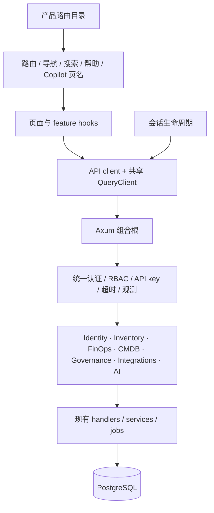

# CloudAtlas 产品与架构复核

复核日期：2026-11-04。依据当前源码、API 返回结构、本地自动化测试与浏览器检查；历史任务清单中的 “Done” 不作为当前行为的验证依据。

## 产品定位与主流程

CloudAtlas 的主线是把云账单、资源、配置项及业务归属连接起来，让用户从“数据是否可信”走到“谁负责、如何改善、如何验证结果”。现有模块已经足够丰富，当前优先级是入口可发现、数据表达准确、操作可恢复和权限一致。

| 使用者 | 核心任务 | 推荐流程 | 结果与成功标准 |
|---|---|---|---|
| 平台管理员 | 建立可信数据源和团队工作区 | 云账号 → 账单导入 → 数据流 → 成员/邀请 | 同步/导入状态可查，覆盖缺口可定位，成员权限正确 |
| FinOps 负责人 | 解释支出、分摊成本和跟进优化 | 首页 → 费用分析/成本地图 → 成本池/分摊 → 优化建议 | 时间窗口与币种一致；请求失败不显示零成本；建议保留证据与状态 |
| 资产管理员 | 建模、发现和维护配置项 | CI 类型 → 发现/导入 → CMDB/拓扑 → 漂移/审计 | 资源关联可追溯，模型变更受权限控制，漂移有处理状态 |
| 业务负责人 | 理解服务与成本责任 | 服务 → 成本中心 → Showback → 预算/告警 | 能沿业务归属追踪成本和异常；未分配成本保持可见 |
| 运维/治理人员 | 发现异常并完成处置 | 标签覆盖/合规 → 动态分组 → 规则/计划 → 任务/事件 | 操作状态可查；失败与尚未执行明确区分 |

保留现有六个导航分组和 URL，减少用户迁移成本。全局搜索增加功能页直达，允许中文、英文和路径搜索；无工作区或后端搜索失败时仍可导航。新增可发现的 CMDB 审计入口。帮助、面包屑和 Copilot 页名统一使用路由目录，避免模块新增时漏接入口或显示错误上下文。

## 模块复核与边界

以下是代码与产品入口的复核矩阵，不代表已对每个云厂商或外部服务完成线上验收。

| 产品域 | 前端入口/模块 | 后端归属 | 本次判断 |
|---|---|---|---|
| 工作区与身份 | 登录、设置、邀请 | `auth`, `api_keys` | 统一前端会话清理；修复认证路由归属和邀请链路 |
| 数据接入 | 云账号、账单导入、数据流 | `cloud`, `billing`, `jobs` | 保留发现与账单分离的流程；外部账号可见性仍取决于云权限 |
| 成本分析 | 首页、费用、地图、对比、导出 | `expense`, `bi_export` | 首页修正真实响应契约、MTD 范围和失败状态 |
| 责任分配 | 成本池、成本中心、服务、Showback | `expense`, `cmdb`, `rules` | 保留资源→CI→服务→成本中心链路；后续业务逻辑抽取重点 |
| 资源运营 | 资源、生命周期、共享环境、K8s | `resources`, `lifecycle`, `shared_env`, `k8s` | 路由按 inventory 分组；保留现有读写路径 |
| 资产模型与实例 | CMDB、类型、字段模板、关联、拓扑 | `cmdb` | 补齐审计入口及管理权限；大 handler 仍应按用例逐步拆分 |
| 成本与资产治理 | 合规、标签、漂移、异常、约束、计划 | `cmdb`, `tagging`, `constraints`, `power_schedule` | 保持治理入口；模板/唯一约束/漂移写操作补齐 RBAC |
| 优化闭环 | 优化建议、归档、检查清单 | `recommendation` | 首页读取 `open` 数量；归档深链保留 |
| 事件与外部连接 | 告警、事件、Webhooks、集成 | `alert`, `notifications`, `webhook`, `integrations` | 路由按域组织；外部投递与真实云动作需专门环境验证 |
| AI 辅助 | AI 中心、Copilot | `ai` | 页名共享产品目录；保留特定页面建议，不制造未实现的操作能力 |
| 后台执行 | 同步任务、调度、执行记录 | `jobs`, `scheduler` | 保持现有 PostgreSQL/进程内执行机制，未增加基础设施 |

## 已确认问题与落地改进

| 优先级 | 问题及影响 | 改进 |
|---|---|---|
| P0 | 首页 `allSettled` 把错误变成 0，可能显示错误的空工作区/零成本 | 每个数据源独立查询；加载、错误、真正空数据分开；局部重试 |
| P0 | 首页读取错误字段：建议 `active_recommendations`、成本池 `current_month_cost`、预测/异常 `data` | 对齐 `open`、`current_month_spend`、`summary/history`、`anomalies`；使用真实响应形状测试 |
| P0 | 首页 MTD 文案对应后端默认近 30 天；账单资源数被误称库存 | 显式月初至当天 UTC 日期；指标标明计费资源；趋势标明近 30 天 |
| P0 | 退出不清工作区/查询缓存；刷新失败悬挂请求；延迟响应可能复活旧会话 | 共享 QueryClient；登录/退出集中清理；会话版本防旧响应；刷新单 Promise 合并且有界重试；Copilot 旧流与历史响应按工作区隔离 |
| P0 | 部分 CMDB 写端点只校验成员，权限映射缺失 | 扩展中央 RBAC 的模板、唯一约束和漂移操作映射，增加读写权限测试 |
| P0 | 需要 Claims 的 2FA/邮件验证/接受邀请注册在公共路由，调用时缺少身份 | 归入受保护 identity 路由；邀请管理要求组织管理权限 |
| P0 | 2FA 登录只依赖英文错误字符串展示输入框，实际错误被通用文案覆盖 | 独立验证码状态，自动聚焦，支持中英文重试；区分凭据、限流和服务异常 |
| P1 | 邀请邮件链接缺少前端承接，登录后丢失目标 | 新增确认页与安全的站内登录/SSO 回跳；显式接受后刷新工作区；后端邮箱绑定与一次性事务兑换 |
| P1 | 路由、导航、帮助、Copilot 页名多处维护，审计入口遗漏 | `app/routeCatalog.ts` 统一元信息，按目录生成路由与导航 |
| P1 | 全局搜索仅查数据且错误表现为“无结果”，旧请求可覆盖新查询 | 本地页面搜索 + 工作区隔离/可取消查询；错误重试；方向键/Enter/Escape |
| P1 | 单页渲染异常会移除整个导航；未知 URL 被静默重定向 | 页面级可重置错误边界保留 shell；明确的 404 引导 |
| P1 | 切换工作区时旧币种响应可能覆盖新选择 | 响应提交前检查当前工作区及 effect 生命周期 |
| P1 | 后端 1335 行集中式路由混合安全边界、业务注册和 OpenAPI | 组合根 + 七个业务路由组 + public/OpenAPI；抽取时逐项比对 276 条注册 |

## 当前架构与依赖方向

- `backend/src/routes.rs` 只负责组合与横切层。`routes/*.rs` 负责协议入口分组，不承担业务逻辑。所有受保护路由先合并，再统一套安全层，避免单个子模块遗漏认证。
- `backend/src/routes/openapi.rs` 保留当前接口文档聚合。路由拆分与权限修复分开验证：抽取先保持 path/method/handler 等价，随后对明确的认证缺陷实施修正。
- `frontend/src/app/routeCatalog.ts` 是已注册产品页面的元信息来源。组件继续 lazy load；邀请确认页等携带凭据的流程页面不加入功能搜索。
- `frontend/src/features/dashboard/`、`features/search/` 包含相应领域的查询契约和数据状态。页面负责展示和交互；跨模块稳定 DTO 继续保留现有公共类型，避免一次性移动全部代码。
- `frontend/src/lib/auth.ts` 是登录、刷新、退出生命周期入口；`lib/queryClient.ts` 提供应用唯一的缓存实例。Zustand 持久化工作区信封格式不变，外观偏好不随退出清空。
- 继续模块化单体和 PostgreSQL 主存储，不增加服务拆分。现有配置含可选 `REDIS_URL` 限流适配，是与严格 PostgreSQL-only 指南存在的历史偏差；默认运行并不需要 Redis。本轮没有扩大该依赖。

## 后续演进顺序

这些是本轮 review 后保留的演进项，不计为已实现功能。

1. **按用例缩小大模块**：优先 CMDB 的实例写入/查询/动态组、expense 的分析/分摊、AI 的配置/会话。提取 service 时保持事务、组织约束、审计及事件在同一用例边界；不为了目录整齐引入无逻辑的 repository 转发层。
2. **接口契约逐步类型化**：先覆盖首页依赖与高频写路径，再回填其余 OpenAPI。统一 `{data, meta}` 需要版本兼容计划，不能直接更改现有预测/异常特殊响应。禁止以宽泛 `any` 掩盖契约差异。
3. **统一 mutation 失效范围**：按 `[domain, orgId, ...]` 整理查询键，使资源导入、模板应用、归属变更能够准确刷新相关报表；保留数据流页作为解释账单/资源差异的入口。
4. **用角色驱动验收**：访客、只读成员、管理者分别验证模型编辑、导入、邀请、漂移处置。每新增写路由必须验证非管理员及跨组织调用，不只验证无 token 的 401。
5. **真实外部能力验收**：云发现/账单权限、邮件邀请投递、Webhook 重试、云资源动作及 AI provider 需要隔离测试账号和可追踪执行记录；本地模拟通过不等于真实服务验收。
6. **实体搜索直达**：现有实体命中仍进入对应模块列表；后续给列表/详情建立稳定的深链参数，使搜索结果直接定位到配置项或资源，保留浏览器返回状态。
7. **文档去历史歧义**：AGENTS 中早期 skeleton/stub 状态与旧迁移序列仅作历史背景。当前实现以源码及可复现验证为准；不把整个产品标记为“全部验证完成”。

## 验证范围

- 前端：路由目录一致性、跨语言功能发现、键盘导航、搜索错误重试/跨工作区晚到响应、首页真实响应契约、会话刷新/退出隔离、工作区币种竞态、邀请确认与登录回跳。
- 后端：组合路由认证边界、方法/静态路由优先级、公开探针/OpenAPI、CMDB/邀请权限映射及已有 library 测试。
- 浏览器：本地开发前端连接现有本地 API，检查登录、首页、搜索、审计入口、404、深浅主题和移动导航。
- 未执行生产部署、数据库迁移或真实云资源变更。外部邮件投递、真实云 API 和 AI provider 不在本轮验收结果之内。

### 本轮执行结果

| 验证 | 结果 |
|---|---|
| `npm --prefix frontend test` | 31 个文件，209 项通过 |
| `npm --prefix frontend run build` | TypeScript + Vite 构建通过，保留页面懒加载 |
| `cargo test --locked` | 230 项通过，0 失败，0 ignored；DATABASE_URL/TEST_DATABASE_URL 都指向独立临时库，DB 测试实际执行 |
| 邀请数据库回归 | 上述测试中包含 6 项真实 PostgreSQL 测试：邮箱绑定、撤销/过期/重放、并发单次消费、权限保留、写失败回滚、锁等待期间过期 |
| `cargo fmt --check` / `cargo clippy --locked -- -D warnings` | 通过 |
| Chromium navigation suite | 12 项通过（含登录 setup），验证全部导航分组、核心链接、主题切换和审计入口 |
| 手动浏览器检查 | 本地 API 登录、首页空数据、浏览器模拟 503 时指标显示“暂不可用”而非零、跨语言搜索与 Enter 导航、404、邀请缺失 token 提示、中文深色 390px 布局及移动抽屉；文档宽度与视口同为 390px |

临时测试数据库已删除。本地浏览器连接的是现有本地 API，后端新代码由独立数据库测试验证，未替换现有运行服务。构建产生的缓存文件不作为源码改动交付。
